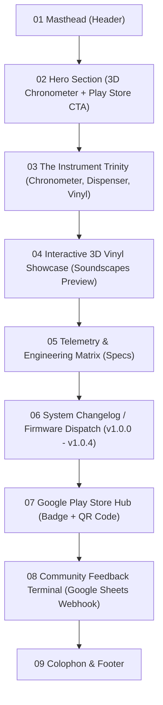

# Design Specification: ZYKL Monastic Focus Hardware Landing Page (`zykl.app`)

- **Author:** Antigravity AI
- **Date:** 2026-09-17
- **Target Folder:** `/home/tuneeca/RSQUARE/Android/zykl.app/`
- **Design Philosophy:** Dieter Rams / 20th-Century German Industrial Modernism (Braun Atelier, TP-1, T1000)
- **Target Build Architecture:** Next.js 15 (App Router) with Static Site Generation (`output: 'export'`)
- **Key 3D & Animation Libraries:** Three.js, `@react-three/fiber`, `@react-three/drei`, `framer-motion`, `tailwindcss`, `lucide-react`

---

## 1. Executive Summary & Goals

The `zykl.app` landing page serves as the official digital showcase and download gateway for the ZYKL Android application. It is designed to reflect the tactile, mechanical, and quiet aesthetics of physical desktop instruments rather than software web tropes.

### Core Constraints & Decisions
1. **Zero AI Slop:**
   - No floating purple blobs, no generic gradient cards, no corporate Memphis illustrations, no hyper-enthusiastic buzzwords.
   - Honest materials: Obsidian Black (`#121316`), Basalt Slate (`#24272C`), Warm Bone Linen (`#F4F2EC` Light mode), Raw Brass (`#C89B3C`), and Filament Amber (`#FF9E00`).
   - Monospace typography with mechanical odometer telemetry labels (`MOD. 01`, `REV. 104`).
2. **SSG Architecture (Zero Backend Server):**
   - Built with Next.js 15 Static Export (`output: 'export'`). Pre-rendered to pure HTML/CSS/JS/WebGL for 0ms TTFB and 100/100 Lighthouse performance.
   - Deployable to Cloudflare Pages, Vercel, or GitHub Pages.
3. **Play Store Exclusive CTA (Zero Direct APK Piracy):**
   - 100% of download CTAs direct users to the official Google Play Store listing.
   - QR Code plate allows desktop visitors to scan and open Play Store instantly on Android phones.
4. **Interactive 3D WebGL Instruments:**
   - **Hero 3D Canvas:** Procedural 3D Analog Chronometer with real-time ticking needle, metallic crown, and gyroscope/mouse tilt parallax.
   - **Vinyl 3D Canvas:** Procedural 3D Braun TP-1 vinyl record with anisotropic light sheen and audio preview player.
5. **System Changelog / Firmware Dispatch (`src/data/changelog.ts`):**
   - Single source of truth containing revision history (v1.0.0 through v1.0.4).
   - Automatically synchronizes masthead build badges, version telemetry, and the dedicated Changelog drawer.
6. **Serverless Feedback Dispatch:**
   - Feedback form formatted as a physical thermal receipt terminal that directly posts to a Google Spreadsheet webhook via Google Apps Script.

---

## 2. Page Structure & Section Architecture



### Section Specifications

#### 01. Industrial Masthead (Header)
- Monolithic ZYKL logotype in knurled steel font.
- Telemetry status pip: `SYSTEM: NOMINAL // BUILD v1.0.4` with soft amber glow.
- Navigation anchor links: `[ INSTRUMENTS ]`, `[ SOUNDSCAPES ]`, `[ SPECS ]`, `[ CHANGELOG ]`, `[ FEEDBACK ]`.
- Theme rocker switch: `OBSIDIAN (DARK)` $\leftrightarrow$ `WARM BONE (LIGHT)` switching full CSS color tokens.

#### 02. Hero Section (3D Chronometer Engine)
- Left / Content Column:
  - Micro-badge: `INSTRUMENT DISPATCH // ANDROID 14+`
  - Headline: **"Quiet Time. Physical Intent."**
  - Subtext: *"A monastic pomodoro instrument inspired by 20th-century German industrial design. No subscriptions, zero accounts, strictly local SQLite."*
  - Play Store Primary CTA button with brass rivets and tactile hover elevation.
- Right Column:
  - Interactive WebGL 3D Canvas (`@react-three/fiber`):
    - Brushed aluminum chronometer bezel, dark dial face with micro ticks, ticking amber needle, and knurled crown.
    - Reacts to mouse pointer coordinates with gentle 3D parallax.

#### 03. The Instrument Trinity (Core Features)
- **Unit 01 // Analog Chronometer:**
  - Pure analog dial face without distracting digital numbers.
  - 3-stage calibration engine (Focus, Short Break, Long Break).
- **Unit 02 // Thermal Receipt Dispenser:**
  - Max 5 task physical queue with serrated tear action and wet ink stamp `[DONE]`.
  - Multi-drawer brass filing cabinet for archived batches.
- **Unit 03 // Monastic Vinyl Turntable:**
  - Braun TP-1 minimalist record player running at 33⅓ RPM.
  - 12 curated procedural soundscapes (dual 6-disc modular drawers).

#### 04. Interactive 3D Vinyl Showcase
- 3D turntable model with revolving vinyl disc.
- Interactive audio preview console: Visitors can click `[ TK-01 LO-FI RAIN ]`, `[ TK-04 KYOTO BAMBOO ]`, or `[ TK-08 WARM TAPE ]` to hear sample audio generated by the app's sound engine directly in the browser.

#### 05. Telemetry & Engineering Matrix
- Table styled as an industrial hardware specifications manual:
  - **Storage:** 100% Offline SQLite (Drift Engine)
  - **DSP Audio:** 22,050 Hz 16-Bit Mono PCM with Sinusoidal Crossfade
  - **Battery Impact:** < 0.1% CPU wake overhead
  - **Telemetry:** Zero third-party trackers, zero advertising SDKs

#### 06. System Changelog / Firmware Dispatch
- Data-driven revision log from `src/data/changelog.ts`.
- Displays version badge (e.g. `v1.0.4 - 2026-09-17`), release notes (3-stage dial calibration, interactive cycle gauge, dark mode strikethrough fix, dual 6-disc drawers).
- Collapsible accordion with monospace teletype formatting.

#### 07. Google Play Store Hub (Dedicated CTA Section)
- Anodized aluminum plate container with corner Allen screws.
- Official Google Play badge button.
- Embedded high-contrast QR Code with tactile brass frame for immediate phone scanning.
- Live telemetry badge: `VERSION 1.0.4 // COMPATIBLE WITH ANDROID 10 - 15`.

#### 08. Community Feedback Terminal
- Styled as a physical thermal receipt print slip.
- Fields: Name / Call-sign, Category (Bug Report, Hardware Suggestion, Soundscape Request), Message.
- Submits asynchronously via `fetch()` to a Google Apps Script Web App URL with tactile print animation upon success.

#### 09. Colophon & Footer
- Dieter Rams' tenet: *"Weniger, aber besser"* (Less, but better).
- Copyright ZYKL Systems & industrial design attribution.

---

## 3. Technology Stack & Project Structure

- **Framework:** Next.js 15 (React 19, App Router)
- **Export Mode:** `output: 'export'` in `next.config.ts`
- **Styling:** Tailwind CSS v3/v4 + CSS Variables for Dark/Light Themes
- **3D Graphics:** Three.js + `@react-three/fiber` + `@react-three/drei`
- **Animation:** `framer-motion` (spring dynamics, layout animations, stagger reveals)
- **Icons:** `lucide-react`

### Directory Layout (`/home/tuneeca/RSQUARE/Android/zykl.app/`)
```
zykl.app/
├── src/
│   ├── app/
│   │   ├── layout.tsx         # Root layout with monospace fonts and theme provider
│   │   ├── page.tsx           # Assembled single-page landing experience
│   │   └── globals.css        # Braun industrial design tokens and scanline noise
│   ├── components/
│   │   ├── 3d/
│   │   │   ├── ChronometerCanvas.tsx  # 3D WebGL Analog Dial
│   │   │   ├── VinylCanvas.tsx        # 3D WebGL Braun TP-1 Vinyl Turntable
│   │   │   └── SceneEnvironment.tsx   # Studio lighting and contact shadows
│   │   ├── sections/
│   │   │   ├── Masthead.tsx           # Header with telemetry status & theme toggle
│   │   │   ├── HeroSection.tsx        # Hero with 3D dial & Play Store CTA
│   │   │   ├── InstrumentTrinity.tsx  # The 3 core hardware modules
│   │   │   ├── VinylShowcase.tsx      # 3D Vinyl preview player
│   │   │   ├── SpecsMatrix.tsx        # Technical specification table
│   │   │   ├── ChangelogSection.tsx   # Firmware dispatch history
│   │   │   ├── PlayStoreCta.tsx       # Dedicated download plate + QR code
│   │   │   ├── FeedbackTerminal.tsx   # Thermal receipt feedback form
│   │   │   └── ColophonFooter.tsx     # Footer attribution
│   │   └── ui/
│   │       ├── TactileButton.tsx      # Mechanical button with spring click
│   │       ├── RivetPlaque.tsx        # Industrial border plate with micro rivets
│   │       └── ThermalReceiptSlip.tsx # Physical slip container with teeth
│   ├── data/
│   │   ├── changelog.ts       # Single source of truth for version history
│   │   └── soundscapes.ts     # Preview track catalog
│   └── lib/
│       └── utils.ts           # Classnames helper
├── public/
│   ├── audio/                 # Web-optimized soundscape preview snippets
│   └── images/                # App icons, QR code preview, mockups
├── package.json
├── tsconfig.json
├── tailwind.config.ts
└── next.config.ts
```

---

## 4. Verification & Quality Gates

1. **Build Verification:** `npm run build` must produce a static export (`out/` directory) with 0 TypeScript diagnostics and 0 build errors.
2. **Design Integrity:** Verification in both Light (*Warm Bone*) and Dark (*Obsidian*) themes.
3. **Mobile Responsiveness:** 3D canvases must adapt seamlessly on mobile screens without lagging or overflowing viewport boundaries.
4. **Feedback Functionality:** Feedback form must validate inputs and dispatch cleanly to Google Apps Script endpoint.
